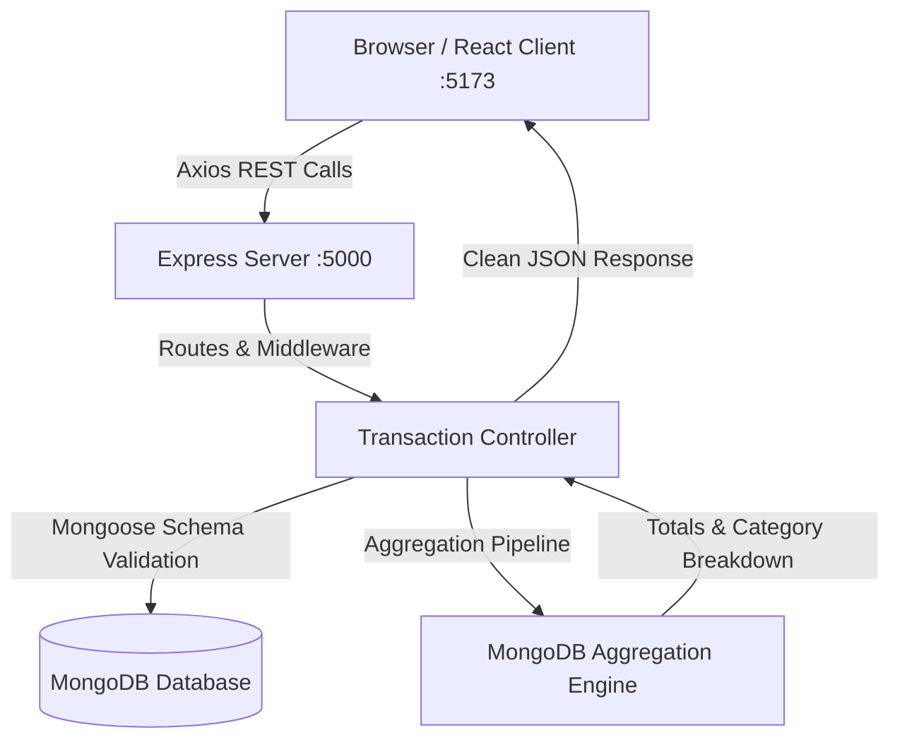
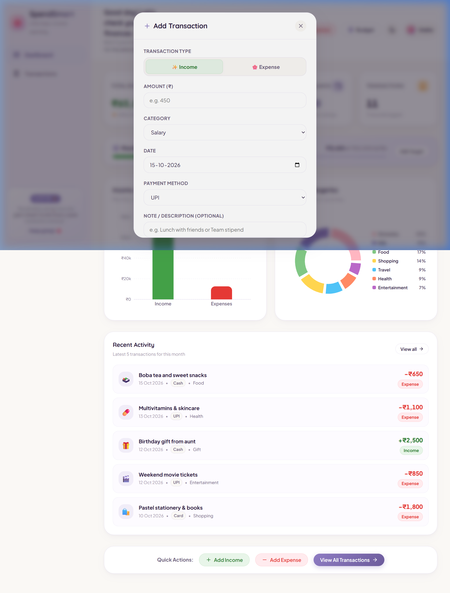

# 🌸 SpendSmart — Cute Personal Expense Tracker

> *"Little steps, smarter spending."* ✨

SpendSmart is a modern, responsive, and delightful full-stack personal finance management web application built using the **MERN stack** (MongoDB, Express.js, React, Node.js). Designed with a cute pastel aesthetic inspired by modern stationery and productivity apps, SpendSmart helps students and professionals record daily income and expenses, organize transactions, monitor monthly budgets, and analyze spending habits through interactive charts.

---

## 📌 Table of Contents

- [Problem Statement](#-problem-statement)
- [Project Objectives](#-project-objectives)
- [Key Features](#-key-features)
- [Technology Stack](#-technology-stack)
- [System Architecture](#-system-architecture)
- [Folder Structure](#-folder-structure)
- [Database Schema](#-database-schema)
- [REST API Endpoints](#-rest-api-endpoints)
- [MongoDB Aggregation Pipeline](#-mongodb-aggregation-pipeline)
- [Prerequisites & Installation](#-prerequisites--installation)
- [Environment Configuration](#-environment-configuration)
- [Running the Application](#-running-the-application)
- [Seeding Demonstration Data](#-seeding-demonstration-data)
- [Automated & Postman API Testing](#-automated--postman-api-testing)
- [Faculty Demonstration Walkthrough](#-faculty-demonstration-walkthrough)
- [Screenshots](#-screenshots)
- [Limitations & Future Roadmap](#-limitations--future-roadmap)

---

## 💡 Problem Statement

Many personal finance and expense tracking applications are either overly complex, cluttered with ads, or styled like sterile, uninspired corporate spreadsheets. As a result, students and young professionals often abandon manual budgeting. SpendSmart resolves this by blending **robust engineering** (genuine MongoDB aggregation pipelines, strict server validations, real-time date filtering) with an **approachable, cute, and calming pastel UI/UX** that makes tracking daily money habits feel rewarding.

---

## 🎯 Project Objectives

1. Provide an intuitive interface to log income and expenses with date, payment method, category, and notes.
2. Ensure **all** dashboard totals, charts, and metrics are dynamically computed by the backend and persisted in MongoDB.
3. Utilize native **MongoDB Aggregation Pipelines** (`$match`, `$facet`, `$group`, `$sum`, `$sort`) for monthly summaries.
4. Support instant monthly date filtering (`YYYY-MM`) with zero-value safety for empty months.
5. Provide helpful enhancements: Monthly spending budget warnings, CSV export, and Light/Dark pastel themes.
6. Meet all requirements for academic mini-project presentations and software engineering portfolios.

---

## ✨ Key Features

### 1. 🔮 Spending Personality Engine (User Archetypes)
Analyzes real transaction history and savings rate to reveal the user's spending psychology without needing external AI APIs:
- **🍱 The Foodie**: Spends most on dining, cafes, and gourmet treats.
- **🛡️ The Careful Saver**: Expenses remain low relative to income (Savings Rate ≥ 60%).
- **🦋 The Social Butterfly**: Spends more on entertainment, travel, and outings.
- **🛍️ The Trendsetter**: Shopping and fashion lifestyle dominance.
- **📚 The Self-Improver**: Education and personal wellness priority.
- **⚖️ The Balanced Zen**: Harmoniously distributed spending across all categories.
- **🌱 The Clean Slate**: Freshly registered users with zero expenses waiting to build their profile.

### 2. 🔮 What-If Money Simulator (Decision Lab)
Interactive real-time calculation engine allowing users to test financial choices before making them:
- **“Can I afford a ₹5,000 purchase this month?”**: Real-time slider and presets showing immediate impact on remaining balance and budget buffer with **Affordable & Safe**, **Tight Budget Caution**, or **Over Budget Deficit** verdicts.
- **“What if I spend ₹500 less on food every week?”**: Calculates ₹2,000/mo cuts with 6-month (+₹12,000), 1-year (+₹24,000), and 3-year (+₹72,000) wealth gains and how it accelerates your dream savings targets.
- **“What if I save ₹2,000 every month?”**: Simulates monthly savings compounding at 8% annual return over 6 months, 1 year, and 3 years.

### 3. 🎯 Dream Targets & Winning Quests (Gamification)
- Create target savings goals with custom emojis, target amounts, and deadlines.
- Interactive deposits with animated progress bars.
- Reaching 100% triggers a **Winning Celebration Modal** with canvas confetti and trophies.
- **Trophy Showcase**: Unlockable achievement badges based on budget adherence, goal completions, and savings discipline.

### 4. 🔐 Dual-Mode Authentication & Multi-Tenancy
- **One-Click Instant Demo Login**: Pre-seeded with rich sample transactions (₹65,000 income, ₹12,650 expenses, ₹52,350 balance, 11 transactions, and 2 active targets) for effortless demonstrations.
- **Fresh Account Registration**: Newly registered accounts start strictly at **₹0 amount and clean slate** with 0 transactions and 0 goals. All user data is strictly isolated by `userId`.

### 5. 📊 Dashboard Financial Analytics
- **4 Summary Cards**: Total Income, Total Expenses, Available Balance, and Transaction Count formatted in Indian Rupees (`₹`).
- **Income vs Expenses Bar Chart**: Recharts bar visualization with custom rounded bars and formatted tooltips.
- **Category Donut Chart**: Expense category breakdown showing percentages, amounts, and readable pastel legend.
- **Recent Activity**: Latest records with quick navigation to full history.

### 6. 🎯 Monthly Spending Budget
- Set a target monthly limit.
- Visual progress bar that turns yellow at 80% caution and red with an alert when exceeded.

### 7. 📝 Full Transaction Management
- **Add / Edit / Delete Transactions**: Modal forms with INR validation, category select, date picker, and payment methods (Cash, UPI, Card, Net Banking).
- **Search & Filters**: Instant search by note or category, filter by type, payment method, and sorting.
- **CSV Export**: One-click download of the current filtered month's records.

### 8. 🎨 Aesthetic Theme Switcher & Centered Modals
- Seamless toggle between **Cute Light Pastel** and **Cozy Dark Pastel**.
- All modals are fixed centered with `inset: 0` and blur backdrop, preventing layout shifting or side overlapping.

---

## 🛠️ Technology Stack

| Layer | Technologies Used | Purpose |
|---|---|---|
| **Frontend** | React 18, Vite | Single-page application UI & fast HMR |
| **Styling** | Vanilla CSS (CSS3 custom properties) | Theme tokens, responsive grid/flexbox, animations |
| **Data Viz** | Recharts | Responsive SVG charts (Bar & Donut charts) |
| **Icons** | Lucide React | Modern, clean vector iconography |
| **Notifications**| React Hot Toast, Canvas Confetti | Floating alert toasts and celebratory micro-animations |
| **HTTP Client** | Axios | REST API communication with base URL config |
| **Backend** | Node.js, Express.js | REST API routing, validation, error handling |
| **Database** | MongoDB, Mongoose 8 | Document storage, indexes, and aggregation pipelines |
| **Testing** | Supertest, MongoMemoryServer | End-to-end automated API and aggregation test suite |

---

## 🏗️ System Architecture



---

## 📁 Folder Structure

```
expense_tracker_fullstack/
├── backend/
│   ├── config/
│   │   └── db.js                 # MongoDB connection & fallback configuration
│   ├── controllers/
│   │   ├── transactionController.js # CRUD & MongoDB aggregation pipelines
│   │   └── budgetController.js      # Monthly budget endpoints
│   ├── middleware/
│   │   └── errorHandler.js          # Not found & Mongoose error handling
│   ├── models/
│   │   ├── Transaction.js           # Transaction Mongoose model & indexes
│   │   └── Budget.js                # Budget Mongoose model
│   ├── routes/
│   │   ├── transactionRoutes.js     # /api/transactions endpoints
│   │   └── budgetRoutes.js          # /api/budget endpoints
│   ├── scripts/
│   │   ├── seed.js                  # Standalone CLI seed script
│   │   └── seedHelper.js            # Reusable demo data generator
│   ├── tests/
│   │   └── api.test.js              # Automated 15-point API test suite
│   ├── .env.example
│   ├── .env
│   ├── package.json
│   └── server.js                    # Express app initialization & health check
│
├── frontend/
│   ├── public/
│   ├── src/
│   │   ├── components/
│   │   │   ├── Sidebar.jsx          # Left sidebar with logo & navigation
│   │   │   ├── Topbar.jsx           # Topbar with month picker & quick actions
│   │   │   ├── SummaryCards.jsx     # 4 financial summary metric cards
│   │   │   ├── BudgetCard.jsx       # Monthly budget progress tracker
│   │   │   ├── IncomeExpenseChart.jsx # Recharts bar chart
│   │   │   ├── CategoryChart.jsx    # Recharts donut category chart
│   │   │   ├── RecentTransactions.jsx # Latest 5 records
│   │   │   ├── TransactionForm.jsx  # Add/Edit modal form
│   │   │   ├── TransactionList.jsx  # Desktop table and mobile cards
│   │   │   ├── FilterBar.jsx        # Search, filters, sort, CSV export
│   │   │   ├── ConfirmDialog.jsx    # Delete confirmation modal
│   │   │   ├── EmptyState.jsx       # Friendly illustrated empty state
│   │   │   └── BudgetModal.jsx      # Budget configuration modal
│   │   ├── pages/
│   │   │   ├── Dashboard.jsx        # Main overview page
│   │   │   └── Transactions.jsx     # All records management page
│   │   ├── services/
│   │   │   └── api.js               # Axios API client
│   │   ├── styles/
│   │   │   ├── index.css            # Pastel theme design tokens
│   │   │   ├── layout.css           # Shell, sidebar, and navbar styles
│   │   │   ├── dashboard.css        # Cards and chart grid styles
│   │   │   ├── transactions.css     # Filter bar and table styles
│   │   │   └── components.css       # Modals, buttons, and alerts
│   │   ├── utils/
│   │   │   └── formatters.js        # INR currency, date, and icon helpers
│   │   ├── App.jsx                  # Root state & modal coordinator
│   │   └── main.jsx                 # Vite React entry point
│   ├── .env.example
│   ├── .env
│   ├── index.html
│   ├── vite.config.js
│   └── package.json
│
├── postman/
│   └── SpendSmart_API.postman_collection.json # Ready-to-import Postman suite
├── docs/
│   └── screenshots/
│       └── dashboard_preview.png
└── README.md
```

---

## 🗄️ Database Schema

### `Transaction` Model (`backend/models/Transaction.js`)

| Field | Type | Required | Constraints / Validation |
|---|---|---|---|
| `amount` | `Number` | Yes | Finite number `> 0`, rounded to 2 decimals |
| `type` | `String` | Yes | Enum: `['income', 'expense']` |
| `category` | `String` | Yes | Non-empty trimmed string, max 50 chars |
| `date` | `Date` | Yes | Valid Date object |
| `paymentMethod` | `String` | Yes | Enum: `['Cash', 'UPI', 'Card', 'Bank Transfer', 'Other']` |
| `note` | `String` | No | Optional, trimmed, max 200 chars |
| `createdAt` | `Date` | Auto | Mongoose timestamp |
| `updatedAt` | `Date` | Auto | Mongoose timestamp |

**Indexes created**:
- `{ date: -1 }` (for fast monthly date range queries)
- `{ type: 1 }`
- `{ category: 1 }`
- `{ date: -1, type: 1 }`

---

## 🔌 REST API Endpoints

| Method | Endpoint | Description | Query / Body Parameters |
|---|---|---|---|
| `GET` | `/api/health` | Health check & DB connection status | None |
| `GET` | `/api/transactions` | Retrieve transactions | `?month=YYYY-MM&type=&category=&paymentMethod=&search=&sortBy=&sortOrder=` |
| `POST` | `/api/transactions` | Create a new transaction | Body: `{ amount, type, category, date, paymentMethod, note }` |
| `PUT` | `/api/transactions/:id` | Update an existing transaction | Body: `{ amount, type, category, date, paymentMethod, note }` |
| `DELETE` | `/api/transactions/:id`| Delete an existing transaction | URL param: `id` |
| `GET` | `/api/transactions/summary` | Monthly aggregation summary | Query: `?month=YYYY-MM` |
| `GET` | `/api/budget` | Get monthly budget | Query: `?month=YYYY-MM` |
| `POST` | `/api/budget` | Set or update monthly budget | Body: `{ month, amount }` |

---

## ⚙️ MongoDB Aggregation Pipeline

The summary endpoint (`GET /api/transactions/summary?month=YYYY-MM`) uses real MongoDB Aggregation with `$facet` to execute two aggregation streams in a single database pass:

```javascript
const aggregationResult = await Transaction.aggregate([
  // Stage 1: Filter transactions within the month's UTC date boundary
  {
    $match: {
      date: {
        $gte: startDate, // e.g. 2026-10-01T00:00:00.000Z
        $lt: endDate     // e.g. 2026-11-01T00:00:00.000Z
      }
    }
  },
  // Stage 2: Parallel aggregation facets
  {
    $facet: {
      // Sub-pipeline A: Compute Total Income & Total Expenses
      totalsByType: [
        {
          $group: {
            _id: '$type',
            total: { $sum: '$amount' },
            count: { $sum: 1 }
          }
        }
      ],
      // Sub-pipeline B: Compute Expense Categories Breakdown
      categoryBreakdown: [
        { $match: { type: 'expense' } },
        {
          $group: {
            _id: '$category',
            total: { $sum: '$amount' },
            count: { $sum: 1 }
          }
        },
        { $sort: { total: -1 } },
        {
          $project: {
            _id: 0,
            category: '$_id',
            total: { $round: ['$total', 2] },
            count: 1
          }
        }
      ]
    }
  }
]);
```

---

## 🚀 Running the Application Locally

### Prerequisites
- Node.js (v18.0.0 or higher recommended; v24 is verified)
- npm (v9.0.0 or higher)
- MongoDB: One of the following:
  - Local **MongoDB Community Server** running on `mongodb://127.0.0.1:27017`
  - **MongoDB Atlas** connection string
  - Out-of-the-box **Isolated Engine** (`USE_MEMORY_DB=true` in `backend/.env`) which requires zero local MongoDB installation!

### Step 1: Clone or Navigate to the Workspace
```bash
cd expense_tracker_fullstack
```

### Step 2: Configure Environment Variables

**Backend (`backend/.env`)**:
```env
PORT=5000
MONGODB_URI=mongodb://127.0.0.1:27017/spendsmart
USE_MEMORY_DB=true
AUTO_SEED_IF_EMPTY=true
NODE_ENV=development
```
*(If you have a local MongoDB service running, simply change `USE_MEMORY_DB=false`)*

**Frontend (`frontend/.env`)**:
```env
VITE_API_URL=http://localhost:5000/api
```

### Step 3: Start the Backend Server
```bash
cd backend
npm install
npm start
```
*Backend runs on: `http://localhost:5000`*

### Step 4: Start the Frontend Application
Open a new terminal window:
```bash
cd frontend
npm install
npm run dev
```
*Frontend runs on: `http://localhost:5173`*

---

## 🧪 Testing

### 1. Automated Test Suite (15 Test Cases)
Run the automated test suite verifying all 5 endpoints, edge cases, validation rules, and aggregation:
```bash
cd backend
npm test
```
**Test Results**:
- `GET /api/health` returns 200 OK
- Reject negative amounts (400)
- Reject missing categories (400)
- Reject invalid transaction types (400)
- POST valid income (₹25,000 Salary) (201)
- POST valid expense (₹450 Food, UPI) (201)
- GET `/api/transactions?month=2026-10` returns monthly records (200)
- GET `/api/transactions/summary` aggregates income, expenses, balance, and category breakdown
- PUT updates transaction amount (₹450 -> ₹500)
- Summary aggregation reflects updated balance
- Reject invalid MongoDB ObjectId (400)
- Return 404 for nonexistent ID
- DELETE transaction
- Summary aggregation reflects deletion
- Empty month returns exact zeroes

### 2. Postman Collection
Import the collection file located at:
`postman/SpendSmart_API.postman_collection.json` into Postman. It includes pre-configured environment variables and test scripts for end-to-end API demonstration.

---

## 🎓 Demonstration Walkthrough

To perform a 5-minute flawless live demonstration:
1. **Open Dashboard (`http://localhost:5173`)**:
   - Point out the 4 summary cards: Total Income, Total Expenses, Available Balance, and Transaction Count.
   - Show the Income vs Expenses bar chart and Category donut chart.
2. **Add Income**:
   - Click **+ Income**. Enter Amount: `25000`, Category: `Salary`, Payment: `Bank Transfer`, Note: `Monthly Stipend`.
   - Submit and observe the green success toast, celebratory confetti, and instant update of Total Income and Balance.
3. **Add Expense**:
   - Click **- Expense**. Enter Amount: `450`, Category: `Food`, Payment: `UPI`, Note: `Lunch`.
   - Submit and show the immediate update in the Expenses summary card, Bar chart, and Category breakdown.
4. **Edit the Transaction**:
   - Navigate to the **Transactions** tab. Find `Lunch` and click the purple **Edit** pencil icon.
   - Change `450` to `500` and save. Verify the amount updates to `₹500` in the table and dashboard summary.
5. **Delete the Transaction**:
   - Click the red **Trash** icon. Review the custom confirmation modal showing the transaction details.
   - Click **Yes, Delete**. Verify the item disappears and totals recalculate.
6. **Month Filtering & Empty Month**:
   - Change the month selector in the top bar to `2026-09` to demonstrate historical data.
   - Change the month selector to an unused month (e.g., `2029-01`). Show the clean zero values and friendly empty states.
7. **CSV Export & Theme Toggle**:
   - Click **Export CSV** to download a spreadsheet file of the current month.
   - Click the **Sun/Moon** icon in the topbar to showcase the cozy dark pastel theme.

---

## 📷 Screenshots



---

## 🔮 Limitations & Future Roadmap

- **Multi-user Authentication**: Current version is designed as a single-user personal tracker for straightforward mini-project presentation. Future releases can incorporate JWT/OAuth authentication.
- **Recurring Transactions**: Scheduled automatic entry for regular monthly bills and salary deposits.
- **Receipt Image Uploads**: Cloudinary integration for attaching physical receipt photos to expense records.
